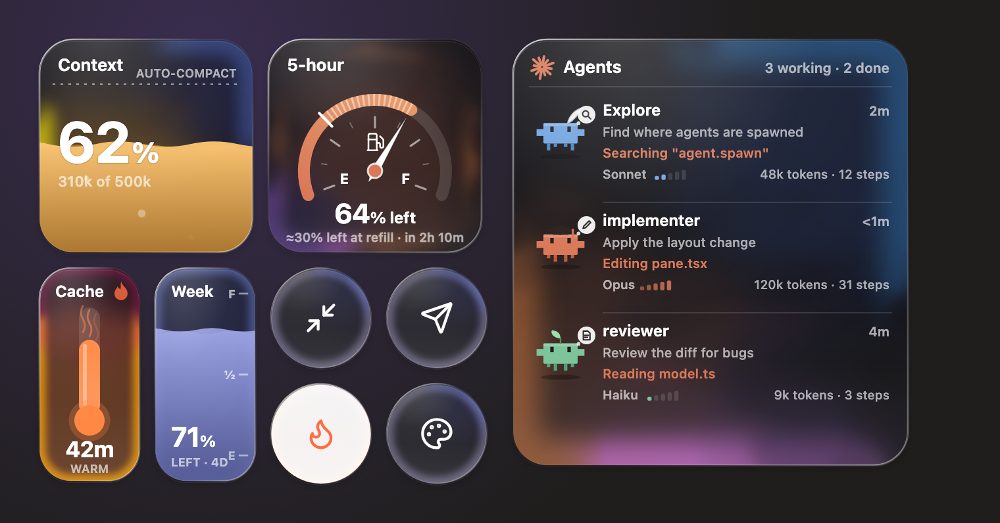
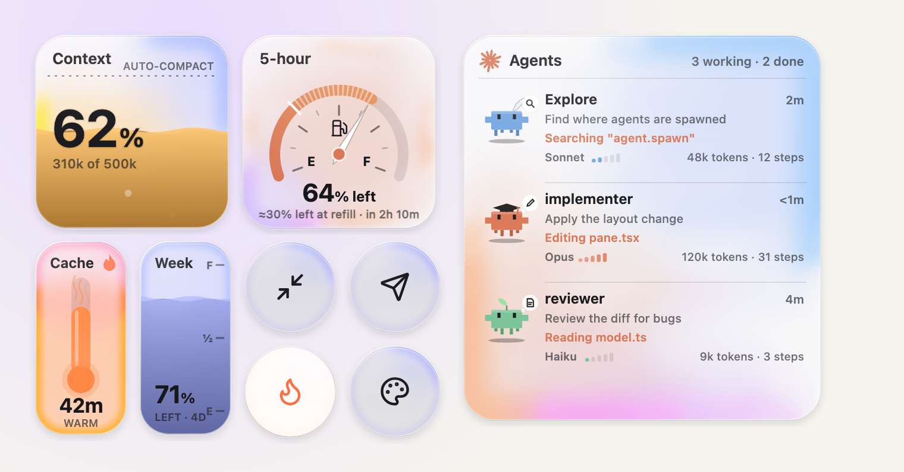

# Cockpit: a Control Center for Claude Code

A Liquid Glass control centre for the Claude Code desktop app, in the spirit of the one on iPhone and Mac. It shows how full the chat is, how warm the cache is and how much of your plan is left, and gives you round buttons for the things you reach for most.





## What's in it

- **Context**: a glass of liquid that fills toward the auto-compact line, with a guess at how many turns are left. While Claude compacts, the glass drains.
- **5-hour limit**: a fuel gauge whose needle falls from F to E. A tick on the dial marks where the needle will be when the window refills at your current pace, and the line under it says how much will be left. If you're on track to run out first, it says when.
- **Cache**: a thermometer that cools as the prompt cache gets close to expiring, and turns to ice once it has gone cold.
- **Week limit**: a fuel tank showing what is left of the week.
- **Round buttons**:
  - **Compact** summarises the chat to free room.
  - **Handoff** writes a `HANDOFF.md` with next steps so you can start a fresh chat.
  - **Keep warm** sends a tiny ping before the cache expires, so coming back to a chat stays cheap.
  - **Customize** opens the colour and opacity picker for the glass.
- **Agents**: a crab for each subagent at work, showing its model, effort, task and what it is doing right now.

To open or close the Control Center, press the ⚌ button at the right of the chat box's footer; it turns into ✕ while the Control Center is open. You can also type `/cockpit`. It opens by itself when a chat starts unless you turn that off.

In a terminal session the same readings show as text in a band above the prompt.

## Install

At the prompt of a terminal session:

```
/plugin install cockpit --marketplace ilyasalmd/controlcentre_id
```

Answer `y` to add the marketplace, then pick a scope.

From a shell:

```bash
claude plugin install cockpit --marketplace ilyasalmd/controlcentre_id
```

In the desktop app, where `/plugin` does not run: click **+** next to the prompt box, then **Plugins**, **Add marketplace** with `ilyasalmd/controlcentre_id`, then **Add plugin**.

Cockpit is a mod: it uses Claude Code's mod system to draw its pane, so it needs a Claude Code version with mods. An organisation's settings can stop mods installed by users from running.

## Commands

| Command | What it does |
| :- | :- |
| `/cockpit` | Opens or closes the Control Center |
| `/cockpit color <name\|#hex\|none>` | Tints the glass |
| `/cockpit opacity <0-100\|clear\|tinted>` | Sets how see-through the glass is |
| `/cockpit keepwarm on\|off` | Turns keep-warm on or off |
| `/cockpit pin <command>` | Pins a command in the terminal launcher |

## Settings

Set these when you enable the plugin, or later in its options.

| Setting | Default | What it does |
| :- | :- | :- |
| `compactAt` | `0` | Where Claude compacts the chat by itself. `0` reads your `autoCompactWindow` setting, or 400,000 tokens. |
| `cacheLife` | `auto` | `auto` is 1 hour on a subscription and 5 minutes on an API key. |
| `density` | `standard` | How much the terminal band shows: `calm`, `standard` or `full`. |
| `keepWarm` | off | Starts each session with keep-warm on. Each ping is a small model request. |
| `keepWarmHours` | `3` | How long keep-warm runs once turned on. |
| `guardTokens` | `100000` | Holds the first message after the cache goes cold, once, when the chat is at least this big, so you can compact first. Send it again to go ahead. `0` turns this off. |
| `openAtStart` | on | Opens the Control Center beside each new chat. |

## Developing

```bash
npx tsc -p .
claude plugin validate .
claude plugin test .
```

The type-check needs the API types, which Claude Code writes into `.claude-plugin/types/` the first time it loads the mod. To run your working copy, start Claude Code with `--plugin-dir <this folder>`.

## Licence

MIT. See [LICENSE](LICENSE).
